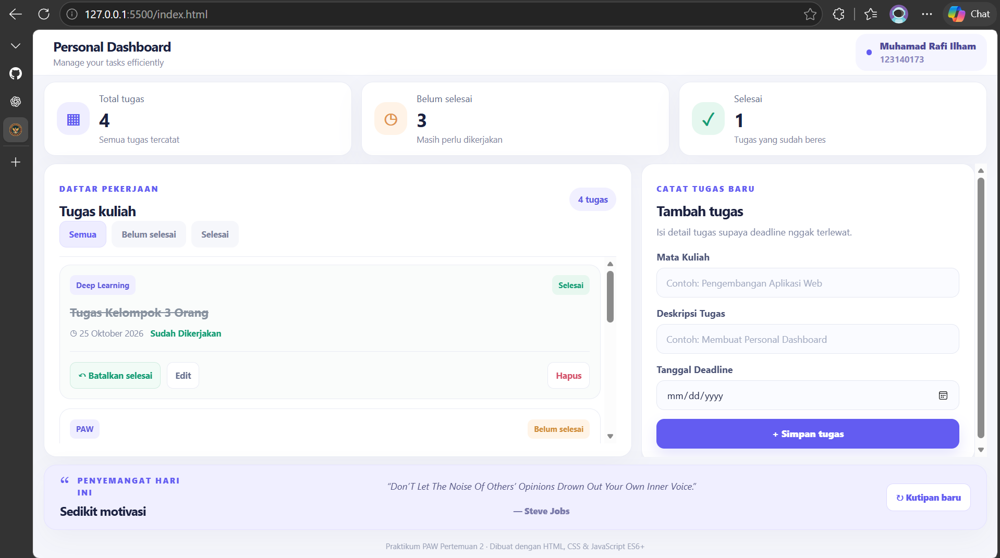

# Personal Dashboard — Manajemen Tugas Kuliah

**Nama:** Muhamad Rafi Ilham  
**NIM:** 123140173  
**Kelas:** PAW RB  
**Mata Kuliah:** Pengembangan Aplikasi Web  
**Pertemuan:** 2 — Modern JavaScript ES6+

---

## 1. Deskripsi Aplikasi

Personal Dashboard adalah aplikasi web untuk membantu mahasiswa mencatat, mengelola, dan memantau tugas perkuliahan secara praktis.

Pengguna dapat menambahkan tugas berdasarkan mata kuliah, deskripsi tugas, dan tanggal deadline. Aplikasi juga menyediakan fitur untuk mengedit, menghapus, menandai tugas selesai, serta menyaring daftar tugas berdasarkan status pengerjaan.

Dashboard menampilkan statistik jumlah tugas secara otomatis dan informasi sisa waktu menuju deadline.

Aplikasi dibangun menggunakan **HTML5, CSS3, dan JavaScript ES6+** tanpa framework tambahan. Data tugas disimpan menggunakan `localStorage` agar tetap tersedia setelah halaman dimuat ulang.

Selain itu, aplikasi menggunakan Fetch API dan `async/await` untuk menampilkan kutipan inspirasi dari API publik.

## 2. Fitur Aplikasi

| Fitur | Deskripsi |
|---|---|
| Tambah Tugas | Menambahkan mata kuliah, deskripsi tugas, dan tanggal deadline. |
| Edit Tugas | Mengubah informasi tugas yang sudah tersimpan. |
| Hapus Tugas | Menghapus tugas dengan konfirmasi pengguna. |
| Tandai Selesai | Mengubah status tugas menjadi selesai atau belum selesai. |
| Statistik Tugas | Menampilkan jumlah total tugas, belum selesai, dan selesai. |
| Filter Tugas | Menampilkan semua tugas atau tugas berdasarkan status pengerjaan. |
| Informasi Deadline | Menampilkan tanggal deadline dan sisa hari pengerjaan. |
| localStorage | Menyimpan data tugas secara lokal pada browser. |
| Kutipan Inspirasi | Mengambil kutipan secara asinkron dari DummyJSON API. |
| Responsive Design | Menyesuaikan tata letak halaman dengan ukuran layar. |

## 3. Teknologi yang Digunakan

| Teknologi | Kegunaan |
|---|---|
| HTML5 | Membuat struktur halaman aplikasi. |
| CSS3 | Mengatur desain, warna, layout, dan responsivitas. |
| JavaScript ES6+ | Mengelola data, fungsi, dan interaktivitas. |
| DOM Manipulation | Menampilkan dan memperbarui data tugas secara dinamis. |
| localStorage | Menyimpan tugas pada penyimpanan browser. |
| Fetch API | Mengambil data dari API eksternal. |
| Async/Await | Mengelola proses asynchronous programming. |

## 4. Struktur Folder Proyek

```text
Muhamad Rafi Ilham_123140173_pertemuan2/
│
├── modul/
│   ├── index.html
│   ├── 01_variabel_arrow_template.js
│   ├── 02_destructuring_spread.js
│   ├── 03_classes_object.js
│   ├── 04_array_methods.js
│   └── 05_async_programming.js
│
├── index.html
├── css/
│   └── style.css
├── js/
│   └── app.js
├── screenshots/
│   └── dashboard.png
└── README.md
```

Folder `modul` berisi latihan JavaScript ES6+ Pertemuan 2, sedangkan `index.html`, `css/style.css`, dan `js/app.js` merupakan implementasi aplikasi Personal Dashboard.

## 5. Screenshot Aplikasi

### Tampilan Personal Dashboard



Screenshot menampilkan halaman Personal Dashboard yang terdiri dari statistik tugas, daftar tugas kuliah, formulir input, filter status, dan kutipan inspirasi.

## 6. Implementasi JavaScript ES6+

Berikut adalah penerapan konsep Modern JavaScript ES6+ pada file `js/app.js`.

| Konsep ES6+ | Lokasi Kode | Implementasi |
|---|---|---|
| `const` | Baris 7 | Mendeklarasikan konstanta `STORAGE_KEY`. |
| `let` | Baris 426 | Mendeklarasikan variabel `label` yang berubah sesuai kondisi deadline. |
| Arrow Functions | Baris 11, 21, 32 | Membuat fungsi `escapeHtml`, `formatTanggal`, dan `hitungSelisihHari`. |
| Classes | Baris 47, 62 | Membuat class `TaskItem` dan `DashboardApp`. |
| Constructor | Baris 48, 63 | Menginisialisasi properti objek dan aplikasi. |
| Destructuring | Baris 48, 532 | Mengambil properti objek tugas dan respons API. |
| Spread Operator | Baris 242, 251 | Memperbarui objek tugas dan menambahkan objek baru ke array. |
| Template Literals | Baris 401, 444 | Membuat HTML secara dinamis dan menampilkan data tugas. |
| Array Methods | Baris 240, 303, 381, 421 | Menggunakan `map()` dan `filter()` untuk mengelola daftar tugas. |
| Async/Await | Baris 518, 526 | Menjalankan proses pengambilan kutipan dari API. |
| Error Handling | Baris 524–547 | Menangani kesalahan request API dengan `try/catch/finally`. |

Nomor baris mengacu pada susunan `js/app.js` yang digunakan saat penyusunan dokumentasi.

### 6.1. Penggunaan Class

Aplikasi menggunakan dua class utama:

**TaskItem**

Class `TaskItem` digunakan sebagai struktur objek untuk menyimpan informasi tugas, yaitu ID, nama tugas, mata kuliah, deadline, dan status selesai.

**DashboardApp**

Class `DashboardApp` digunakan untuk mengelola aplikasi secara keseluruhan, termasuk interaksi pengguna, manipulasi DOM, penyimpanan data, filter tugas, dan pengambilan data dari API.

### 6.2. Penggunaan Array Methods

Aplikasi menggunakan beberapa metode array modern:

- `map()` digunakan untuk memperbarui data tugas dan membuat elemen HTML daftar tugas.
- `filter()` digunakan untuk menghapus tugas, menghitung tugas selesai, dan menyaring daftar berdasarkan status.
- `find()` digunakan untuk mencari tugas tertentu ketika pengguna melakukan pengeditan.
- `forEach()` digunakan untuk menambahkan event listener pada tombol filter.

### 6.3. Penggunaan Template Literals

Template literals digunakan untuk menyusun kartu tugas dalam bentuk HTML secara dinamis.

Dengan template literals, data nama tugas, mata kuliah, deadline, serta status pengerjaan dapat ditampilkan tanpa harus membuat elemen HTML secara manual untuk setiap tugas.

### 6.4. Penggunaan Arrow Functions

Arrow functions diterapkan pada fungsi bantuan, event listener, dan pengolahan array.

Contohnya terdapat pada fungsi `escapeHtml`, `formatTanggal`, `hitungSelisihHari`, serta callback `map()` dan `filter()`.

## 7. Implementasi localStorage

Aplikasi menggunakan `localStorage` untuk menyimpan data tugas dalam format JSON.

| Method / Fungsi | Lokasi Kode | Kegunaan |
|---|---|---|
| `loadTasks()` | Baris 98 | Mengambil data tugas dari localStorage. |
| `JSON.parse()` | Baris 102 | Mengubah string JSON menjadi array JavaScript. |
| `saveTasks()` | Baris 127 | Menyimpan perubahan daftar tugas. |
| `JSON.stringify()` | Baris 131 | Mengubah array tugas menjadi string JSON. |

Saat pengguna menambahkan, mengedit, menghapus, atau mengubah status tugas, aplikasi akan memperbarui data yang disimpan.

Ketika halaman dimuat kembali, aplikasi mengambil data dari `localStorage`, sehingga tugas tidak hilang setelah browser direfresh selama penyimpanan browser tidak dibersihkan.

## 8. Implementasi Asynchronous Programming

Aplikasi menggunakan **DummyJSON Quotes API** sebagai sumber data eksternal.

**Endpoint API:**

https://dummyjson.com/quotes/random

Pengambilan data dilakukan melalui method `loadQuote()` menggunakan `fetch()` dan `async/await`.

Alur proses pengambilan data:

1. Aplikasi menampilkan pesan bahwa kutipan sedang dimuat.
2. Fungsi `fetch()` mengirim request ke endpoint API.
3. Respons diperiksa untuk memastikan request berhasil.
4. Data respons diubah menjadi objek JavaScript menggunakan `response.json()`.
5. Properti `quote` dan `author` diambil menggunakan destructuring.
6. Kutipan dan nama penulis ditampilkan pada halaman.
7. Jika request gagal, aplikasi menampilkan pesan kesalahan melalui `try/catch`.
8. Tombol kutipan diaktifkan kembali melalui blok `finally`.

Proses ini berjalan secara asinkron sehingga fungsi pengelolaan tugas lainnya tetap dapat digunakan.

## 9. Cara Menjalankan Aplikasi

1. Buka folder proyek menggunakan Visual Studio Code.
2. Pastikan struktur direktori proyek sudah sesuai.
3. Buka file `index.html` yang berada di folder utama Pertemuan 2.
4. Klik kanan file tersebut, kemudian pilih **Open with Live Server**.
5. Aplikasi akan terbuka melalui browser.
6. Masukkan mata kuliah, deskripsi tugas, dan tanggal deadline untuk menambahkan tugas.
7. Gunakan tombol Edit, Hapus, atau Tandai Selesai untuk mengelola tugas.
8. Gunakan filter untuk menampilkan tugas berdasarkan status pengerjaan.
9. Klik tombol Kutipan baru untuk mengambil kutipan lain dari API.

Aplikasi tidak memerlukan instalasi framework atau dependensi tambahan. Koneksi internet diperlukan untuk mengakses API kutipan.

## 10. Pengujian Aplikasi

Pengujian dilakukan terhadap fungsi utama aplikasi:

| Pengujian | Hasil yang Diharapkan |
|---|---|
| Tambah tugas | Tugas baru muncul pada daftar. |
| Edit tugas | Informasi tugas berubah sesuai input terbaru. |
| Hapus tugas | Tugas terhapus setelah dikonfirmasi. |
| Tandai selesai | Status berubah dan statistik ikut diperbarui. |
| Filter tugas | Daftar menampilkan tugas sesuai filter. |
| Refresh halaman | Tugas tetap tersimpan melalui localStorage. |
| Kutipan baru | Kutipan dari API diperbarui. |
| Tampilan responsif | Halaman menyesuaikan ukuran layar. |

## 11. Kesimpulan

Personal Dashboard merupakan implementasi materi Modern JavaScript ES6+ pada aplikasi manajemen tugas perkuliahan.

Melalui proyek ini, konsep `let` dan `const`, arrow functions, classes, destructuring, spread operator, template literals, array methods, DOM manipulation, `localStorage`, serta asynchronous programming diterapkan dalam sebuah aplikasi interaktif.

Aplikasi ini membantu pengguna mencatat dan memantau tugas kuliah sekaligus menjadi sarana praktik penerapan JavaScript ES6+ dalam pengembangan aplikasi web.