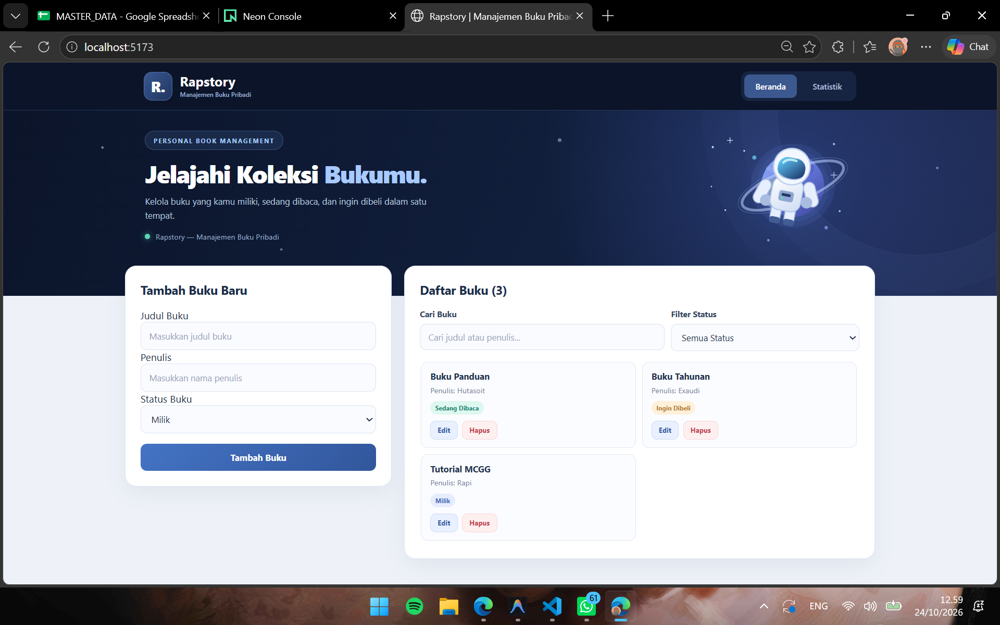
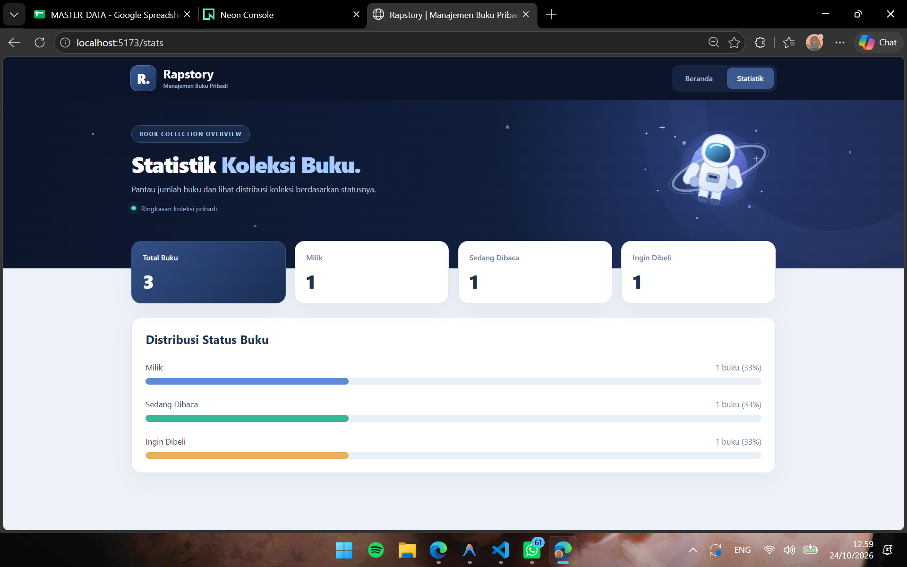
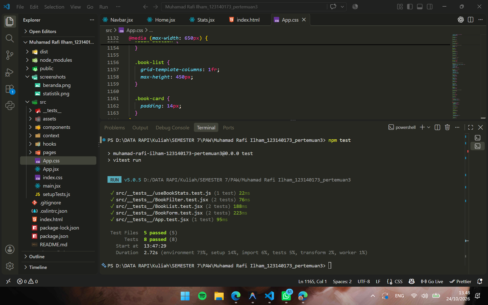

# Rapstory — Manajemen Buku Pribadi

**Nama:** Muhamad Rafi Ilham  
**NIM:** 123140173  
**Kelas:** PAW RB  
**Mata Kuliah:** Pengembangan Aplikasi Web  
**Pertemuan:** 3 — React Basics

---

## 1. Deskripsi Aplikasi

Rapstory adalah aplikasi web untuk membantu pengguna mencatat, mengelola, dan memantau koleksi buku pribadi secara praktis.

Pengguna dapat menambahkan buku berdasarkan judul, nama penulis, dan status koleksi. Status buku dibagi menjadi tiga kategori, yaitu **Milik**, **Sedang Dibaca**, dan **Ingin Dibeli**.

Aplikasi menyediakan fitur untuk mengedit, menghapus, mencari, serta menyaring buku berdasarkan status. Halaman Statistik menampilkan jumlah keseluruhan buku dan persentase koleksi pada setiap kategori secara otomatis.

Rapstory dibangun menggunakan **React.js, JavaScript JSX, CSS3, dan Vite**. Pengelolaan data menggunakan React Hooks dan Context API, sedangkan navigasi antarhalaman menggunakan React Router.

Data buku disimpan menggunakan `localStorage` agar tetap tersedia setelah halaman dimuat ulang tanpa memerlukan database atau backend.

Antarmuka aplikasi menggunakan konsep dashboard bertema luar angkasa dengan ilustrasi astronaut, warna navy dan biru, serta tata letak responsif. Tema ini digunakan sebagai identitas visual tanpa mengubah fungsi utama aplikasi manajemen buku.

## 2. Fitur Aplikasi

| Fitur | Deskripsi |
|---|---|
| Tambah Buku | Menambahkan judul, nama penulis, dan status buku. |
| Edit Buku | Mengubah informasi buku yang sudah tersimpan. |
| Hapus Buku | Menghapus buku dari daftar koleksi. |
| Pencarian Buku | Mencari buku berdasarkan judul atau nama penulis. |
| Filter Status | Menampilkan buku berdasarkan status Milik, Sedang Dibaca, atau Ingin Dibeli. |
| Statistik Buku | Menampilkan jumlah total buku dan jumlah buku pada setiap status. |
| Distribusi Koleksi | Menampilkan persentase status buku menggunakan progress bar. |
| Validasi Form | Memeriksa kolom wajib dan menampilkan pesan kesalahan jika input tidak valid. |
| localStorage | Menyimpan data koleksi secara lokal pada browser. |
| Navigasi Halaman | Berpindah antara Beranda dan Statistik menggunakan React Router. |
| Halaman 404 | Menampilkan pesan ketika pengguna membuka halaman yang tidak tersedia. |
| Responsive Design | Menyesuaikan tampilan aplikasi dengan ukuran layar. |

## 3. Teknologi yang Digunakan

| Teknologi | Kegunaan |
|---|---|
| React.js | Membangun antarmuka aplikasi berbasis komponen. |
| Vite | Menjalankan development server dan melakukan production build. |
| JavaScript JSX | Menuliskan komponen serta logika interaktif React. |
| CSS3 | Mengatur desain, warna, layout, dan responsivitas aplikasi. |
| React Hooks | Mengelola state, efek samping, dan perhitungan data. |
| Context API | Mengelola dan menyediakan data buku secara global. |
| React Router DOM | Mengatur navigasi antarhalaman aplikasi. |
| PropTypes | Memeriksa tipe data props yang diterima komponen. |
| localStorage | Menyimpan data koleksi buku pada browser. |
| Vitest | Menjalankan unit testing secara otomatis. |
| React Testing Library | Menguji perilaku dan interaksi komponen React. |
| Oxlint | Memeriksa potensi masalah dan kualitas kode. |

## 4. Struktur Folder Proyek

```text
Muhamad Rafi Ilham_123140173_pertemuan3/
│
├── public/
│
├── src/
│   ├── assets/
│   │   └── astronaut.svg
│   │
│   ├── components/
│   │   ├── BookFilter/
│   │   │   └── BookFilter.jsx
│   │   ├── BookForm/
│   │   │   └── BookForm.jsx
│   │   ├── BookList/
│   │   │   └── BookList.jsx
│   │   └── Navbar/
│   │       └── Navbar.jsx
│   │
│   ├── context/
│   │   └── BookContext.jsx
│   │
│   ├── hooks/
│   │   ├── useLocalStorage.js
│   │   └── useBookStats.js
│   │
│   ├── pages/
│   │   ├── Home/
│   │   │   └── Home.jsx
│   │   ├── Stats/
│   │   │   └── Stats.jsx
│   │   └── NotFound/
│   │       └── NotFound.jsx
│   │
│   ├── __tests__/
│   │   ├── App.test.jsx
│   │   ├── BookFilter.test.jsx
│   │   ├── BookForm.test.jsx
│   │   ├── BookList.test.jsx
│   │   └── useBookStats.test.js
│   │
│   ├── setupTests.js
│   ├── App.jsx
│   ├── App.css
│   ├── index.css
│   └── main.jsx
│
├── screenshots/
│   ├── beranda.png
│   ├── statistik.png
│   └── hasil-testing.png
│
├── .gitignore
├── .oxlintrc.json
├── index.html
├── package.json
├── package-lock.json
├── vite.config.js
└── README.md
```

Folder `components` berisi komponen antarmuka yang dapat digunakan kembali, sedangkan folder `pages` berisi halaman utama aplikasi.

Folder `context` digunakan untuk pengelolaan data global, folder `hooks` menyimpan custom hooks, dan folder `__tests__` berisi pengujian otomatis.

File `App.jsx` mengatur struktur aplikasi dan navigasi, sementara `App.css` serta `index.css` mengatur tampilan antarmuka.

Folder `screenshots` digunakan untuk menyimpan dokumentasi tampilan aplikasi dan hasil unit testing.

Folder `node_modules` dan `dist` tidak disertakan dalam repository karena telah dikecualikan melalui `.gitignore`.

## 5. Screenshot Aplikasi

### 5.1. Halaman Beranda



Screenshot menampilkan halaman Beranda Rapstory yang terdiri dari navigasi, header bertema luar angkasa, formulir penambahan buku, pencarian, filter status, dan daftar koleksi buku.

Setiap kartu buku menampilkan judul, penulis, status koleksi, serta tombol Edit dan Hapus.

### 5.2. Halaman Statistik



Screenshot menampilkan halaman Statistik yang terdiri dari jumlah total buku, jumlah buku berdasarkan status, dan distribusi koleksi dalam bentuk progress bar.

Data statistik dihitung berdasarkan koleksi yang tersimpan dan diperbarui ketika data buku berubah.

### 5.3. Hasil Unit Testing



Screenshot menampilkan hasil pengujian otomatis menggunakan Vitest dan React Testing Library dengan **5 file pengujian dan 8 skenario pengujian yang berhasil**.

## 6. Implementasi React Basics

Berikut adalah penerapan konsep React Basics pada aplikasi Rapstory.

| Konsep React | Lokasi Kode | Implementasi |
|---|---|---|
| Functional Components | `src/components/` dan `src/pages/` | Membagi antarmuka menjadi komponen dan halaman yang memiliki fungsi masing-masing. |
| JSX | File `.jsx` | Menuliskan struktur tampilan menggunakan sintaks JSX. |
| Props | `BookForm.jsx`, `BookList.jsx`, `BookFilter.jsx` | Mengirimkan data dan callback antar komponen. |
| PropTypes | Komponen yang menerima props | Memeriksa tipe data props yang digunakan komponen. |
| `useState` | `BookForm.jsx`, `Home.jsx`, `useLocalStorage.js` | Mengelola input formulir, buku yang diedit, pencarian, filter, dan data koleksi. |
| `useEffect` | `useLocalStorage.js` | Menyimpan perubahan data buku ke localStorage. |
| `useContext` | `BookContext.jsx` | Mengakses data buku yang disediakan Context API. |
| `useMemo` | `useBookStats.js` | Menghitung statistik koleksi berdasarkan perubahan data buku. |
| Conditional Rendering | `BookForm.jsx`, `BookList.jsx`, `Stats.jsx` | Menampilkan konten berdasarkan kondisi aplikasi. |
| List Rendering | `BookList.jsx`, `Stats.jsx` | Menampilkan daftar buku dan statistik menggunakan `map()`. |
| Event Handling | `BookForm.jsx`, `BookList.jsx`, `BookFilter.jsx` | Menangani input, submit, edit, hapus, pencarian, dan filter. |
| Custom Hooks | `useLocalStorage.js`, `useBookStats.js` | Memisahkan logika penyimpanan dan perhitungan statistik. |

### 6.1. Functional Components

Aplikasi menggunakan functional components untuk memisahkan fungsi antarmuka menjadi beberapa bagian.

**BookForm**

Komponen `BookForm` digunakan untuk menambahkan dan mengedit informasi buku. Formulir memiliki input judul, nama penulis, dan pilihan status buku.

**BookList**

Komponen `BookList` digunakan untuk menampilkan koleksi buku dalam bentuk kartu. Komponen ini juga menyediakan tombol Edit dan Hapus untuk setiap buku.

**BookFilter**

Komponen `BookFilter` digunakan untuk mencari buku berdasarkan judul atau penulis serta menyaring koleksi berdasarkan status.

**Navbar**

Komponen `Navbar` menyediakan navigasi antara halaman Beranda dan Statistik.

**Home, Stats, dan NotFound**

Komponen `Home` menampilkan fitur pengelolaan buku, `Stats` menampilkan ringkasan koleksi, dan `NotFound` digunakan untuk menangani halaman yang tidak tersedia.

Pemisahan komponen membantu menjaga keterbacaan kode, mempermudah pengujian, dan mendukung penggunaan kembali komponen.

### 6.2. Penggunaan Props dan PropTypes

Props digunakan untuk mengirimkan data dari komponen induk ke komponen anak.

Pada halaman `Home`, data buku yang sudah difilter dikirimkan ke `BookList` melalui props `books`.

Komponen `BookList` juga menerima fungsi `onEditBook` dan `onDeleteBook` untuk menangani tindakan pengguna.

Komponen `BookFilter` menerima nilai pencarian dan filter beserta callback untuk memperbarui kedua nilai tersebut.

PropTypes digunakan untuk memeriksa tipe data props sehingga kesalahan penggunaan komponen lebih mudah dideteksi selama pengembangan.

### 6.3. Penggunaan useState

Hook `useState` digunakan untuk menyimpan nilai yang dapat berubah berdasarkan interaksi pengguna.

Pada `Home.jsx`, state yang digunakan meliputi:

- `editingBook` untuk menyimpan buku yang sedang diedit.
- `searchTerm` untuk menyimpan kata kunci pencarian.
- `statusFilter` untuk menyimpan pilihan filter status.

Pada `BookForm.jsx`, `useState` digunakan untuk mengelola nilai input dan pesan validasi.

State koleksi buku juga dikelola melalui custom hook `useLocalStorage`, yang memanfaatkan `useState` untuk mempertahankan data dalam aplikasi.

### 6.4. Penggunaan useEffect

Hook `useEffect` diterapkan pada `useLocalStorage.js`.

Ketika data koleksi berubah, `useEffect` menjalankan proses penyimpanan data terbaru ke localStorage.

Dengan cara ini, perubahan yang dilakukan pengguna dapat tersimpan secara otomatis tanpa harus menekan tombol penyimpanan tambahan.

### 6.5. Event Handling dan Conditional Rendering

Event handling digunakan untuk menangani interaksi pengguna, seperti pengisian formulir, penambahan buku, pengeditan, penghapusan, pencarian, dan filter status.

Conditional rendering digunakan untuk menampilkan antarmuka berdasarkan kondisi tertentu.

Contohnya:

- Formulir menampilkan mode tambah atau edit sesuai buku yang sedang dipilih.
- Pesan validasi muncul ketika kolom wajib belum diisi.
- Daftar buku menampilkan pesan ketika tidak ada data yang sesuai.
- Halaman Statistik menampilkan pesan khusus apabila koleksi masih kosong.

### 6.6. Penggunaan Array Methods

Aplikasi menggunakan beberapa metode array JavaScript untuk mengelola data buku.

- `map()` digunakan untuk memperbarui informasi buku tertentu dan menampilkan elemen daftar.
- `filter()` digunakan untuk menghapus buku, mencari berdasarkan judul atau penulis, dan menyaring status koleksi.
- `filter()` juga digunakan dalam perhitungan jumlah buku berdasarkan kategori pada `useBookStats.js`.

## 7. Implementasi Context API dan localStorage

### 7.1. Context API

Aplikasi menggunakan `BookContext.jsx` sebagai pusat pengelolaan data buku.

| Fungsi | Lokasi Kode | Kegunaan |
|---|---|---|
| `BookProvider` | `BookContext.jsx` | Menyediakan data dan fungsi pengelolaan buku kepada komponen. |
| `useBooks()` | `BookContext.jsx` | Memudahkan komponen mengakses data dari Context API. |
| `addBook()` | `BookContext.jsx` | Menambahkan buku baru ke koleksi. |
| `updateBook()` | `BookContext.jsx` | Memperbarui data buku berdasarkan ID. |
| `deleteBook()` | `BookContext.jsx` | Menghapus buku berdasarkan ID. |

Context API memungkinkan halaman `Home` dan `Stats` menggunakan sumber data buku yang sama tanpa harus mengirimkan props melalui banyak tingkat komponen.

### 7.2. Implementasi localStorage

Aplikasi menggunakan custom hook `useLocalStorage.js` untuk menyimpan data buku secara lokal.

| Method / Hook | Lokasi Kode | Kegunaan |
|---|---|---|
| `useState()` | `useLocalStorage.js` | Menginisialisasi dan mengelola data yang tersimpan. |
| `localStorage.getItem()` | `useLocalStorage.js` | Membaca data dari penyimpanan browser. |
| `JSON.parse()` | `useLocalStorage.js` | Mengubah string JSON menjadi data JavaScript. |
| `useEffect()` | `useLocalStorage.js` | Menjalankan proses penyimpanan saat data berubah. |
| `JSON.stringify()` | `useLocalStorage.js` | Mengubah data JavaScript menjadi string JSON. |
| `localStorage.setItem()` | `useLocalStorage.js` | Menyimpan data terbaru pada browser. |

Data koleksi disimpan menggunakan key `paw_books_pertemuan3`.

Saat pengguna menambahkan, mengedit, atau menghapus buku, state koleksi diperbarui dan perubahan disimpan ke localStorage.

Ketika halaman dimuat ulang, data dibaca kembali dari localStorage sehingga koleksi tetap tersedia selama penyimpanan browser tidak dibersihkan.

Karena menggunakan localStorage, data hanya tersimpan pada browser yang digunakan dan tidak tersinkronisasi secara otomatis antarperangkat.

## 8. Implementasi React Router dan Custom Hooks

### 8.1. React Router

Aplikasi menggunakan React Router untuk mengatur navigasi antarhalaman.

| Route | Komponen | Kegunaan |
|---|---|---|
| `/` | `Home.jsx` | Menampilkan halaman pengelolaan koleksi buku. |
| `/stats` | `Stats.jsx` | Menampilkan statistik dan distribusi koleksi. |
| `*` | `NotFound.jsx` | Menampilkan halaman 404 apabila alamat tidak ditemukan. |

Konfigurasi routing terdapat pada `App.jsx` menggunakan `BrowserRouter`, `Routes`, dan `Route`.

Komponen `Navbar` menggunakan `NavLink` untuk mengatur navigasi dan memberikan penanda pada halaman yang sedang aktif.

Perpindahan halaman dilakukan tanpa memuat ulang keseluruhan aplikasi.

### 8.2. Custom Hook useLocalStorage

Custom hook `useLocalStorage` digunakan untuk memisahkan logika penyimpanan data dari komponen antarmuka.

Hook ini menggabungkan `useState` dan `useEffect` untuk membaca, mengelola, serta menyimpan data secara otomatis.

Dengan penggunaan custom hook, logika penyimpanan tidak perlu dituliskan berulang pada komponen lain.

### 8.3. Custom Hook useBookStats

Custom hook `useBookStats` digunakan untuk menghitung statistik koleksi buku.

Perhitungan yang dilakukan meliputi:

1. Menghitung total seluruh buku.
2. Menghitung jumlah buku berstatus Milik.
3. Menghitung jumlah buku berstatus Sedang Dibaca.
4. Menghitung jumlah buku berstatus Ingin Dibeli.
5. Menghitung persentase setiap kategori terhadap total koleksi.

Hook ini menggunakan `useMemo` untuk menghasilkan perhitungan berdasarkan perubahan data koleksi.

Hasilnya ditampilkan pada halaman Statistik dalam bentuk kartu ringkasan dan progress bar.

## 9. Cara Menjalankan Aplikasi

1. Buka folder proyek menggunakan Visual Studio Code.
2. Pastikan Node.js dan npm sudah terinstal.
3. Buka terminal pada folder utama proyek Pertemuan 3.
4. Jalankan perintah berikut untuk menginstal dependensi:

   ```bash
   npm install
   ```

5. Jalankan development server menggunakan perintah:

   ```bash
   npm run dev
   ```

6. Buka alamat yang ditampilkan oleh Vite, biasanya `http://localhost:5173/`.
7. Gunakan formulir untuk menambahkan judul, penulis, dan status buku.
8. Gunakan tombol Edit dan Hapus untuk mengelola koleksi.
9. Gunakan pencarian dan filter untuk menampilkan buku sesuai kebutuhan.
10. Klik menu Statistik untuk melihat ringkasan koleksi.
11. Untuk menjalankan unit testing, gunakan:

    ```bash
    npm test
    ```

12. Untuk membuat production build, gunakan:

    ```bash
    npm run build
    ```

13. Untuk memeriksa kualitas kode, gunakan:

    ```bash
    npm run lint
    ```

Aplikasi tidak memerlukan database atau backend karena data buku disimpan melalui localStorage.

Folder `node_modules` tidak perlu diunggah ke GitHub. Dependensi dapat dipasang kembali menggunakan `npm install`.

## 10. Pengujian Aplikasi

Pengujian dilakukan terhadap fungsi utama aplikasi menggunakan pengujian manual dan unit testing otomatis.

### 10.1. Pengujian Fungsional

| Pengujian | Hasil yang Diharapkan |
|---|---|
| Tambah buku | Buku baru muncul pada daftar koleksi. |
| Edit buku | Informasi buku berubah sesuai input terbaru. |
| Hapus buku | Buku yang dipilih terhapus dari daftar. |
| Validasi form | Pesan kesalahan muncul apabila judul atau penulis kosong. |
| Pencarian buku | Daftar menampilkan buku yang sesuai dengan judul atau penulis. |
| Filter status | Daftar menampilkan buku berdasarkan status yang dipilih. |
| Statistik koleksi | Jumlah dan persentase buku sesuai dengan data koleksi. |
| Navigasi halaman | Beranda dan Statistik dapat dibuka melalui menu navigasi. |
| Halaman 404 | Pesan halaman tidak ditemukan muncul untuk URL yang tidak tersedia. |
| Refresh halaman | Data buku tetap tersimpan melalui localStorage. |
| Tampilan responsif | Tata letak menyesuaikan ukuran layar. |

### 10.2. Unit Testing

Unit testing dilakukan menggunakan **Vitest dan React Testing Library**.

| No. | File Pengujian | Skenario | Hasil |
|---|---|---|---|
| 1 | `BookForm.test.jsx` | Validasi formulir ketika input wajib kosong. | Passed |
| 2 | `BookForm.test.jsx` | Pengiriman data ketika formulir valid. | Passed |
| 3 | `BookList.test.jsx` | Tampilan ketika daftar buku kosong. | Passed |
| 4 | `BookList.test.jsx` | Pemanggilan fungsi hapus berdasarkan ID buku. | Passed |
| 5 | `BookFilter.test.jsx` | Perubahan kata kunci pencarian. | Passed |
| 6 | `BookFilter.test.jsx` | Perubahan filter status. | Passed |
| 7 | `useBookStats.test.js` | Perhitungan jumlah dan persentase koleksi. | Passed |
| 8 | `App.test.jsx` | Tampilan halaman 404 untuk URL tidak dikenal. | Passed |

Hasil pengujian menggunakan perintah `npm test`:

```text
Test Files  5 passed (5)
     Tests  8 passed (8)
```

Seluruh **8 skenario unit testing berhasil dijalankan**.

### 10.3. Production Build

Production build dilakukan menggunakan perintah `npm run build`.

Hasil pengujian build:

```text
vite v8.3.5 building client environment for production...
✓ 38 modules transformed.
✓ built in 267ms
```

Hasil tersebut menunjukkan bahwa aplikasi berhasil dibangun menggunakan Vite untuk lingkungan produksi.

### 10.4. Pemeriksaan Kode

Pemeriksaan kode dilakukan menggunakan Oxlint melalui perintah `npm run lint`.

Hasil pemeriksaan:

```text
Found 1 warning and 0 errors.
```

Satu warning berasal dari aturan `react(only-export-components)` pada `BookContext.jsx`, karena file tersebut mengekspor komponen dan custom hook secara bersamaan.

Warning tersebut tidak menyebabkan kegagalan unit testing maupun production build.

## 11. Kesimpulan

Rapstory merupakan implementasi materi React Basics pada aplikasi manajemen buku pribadi berbasis web.

Melalui proyek ini, konsep functional components, JSX, props, PropTypes, `useState`, `useEffect`, `useContext`, `useMemo`, Context API, React Router, custom hooks, dan pengolahan array diterapkan dalam sebuah aplikasi interaktif.

Aplikasi mendukung penambahan, pengeditan, penghapusan, pencarian, dan filter buku, serta menyediakan halaman statistik untuk memantau distribusi koleksi.

Penggunaan `localStorage` memungkinkan data tetap tersimpan setelah halaman dimuat ulang, sedangkan pengujian menggunakan Vitest dan React Testing Library memastikan sejumlah fungsi utama berjalan sesuai harapan.

Rapstory juga menerapkan desain responsif bertema luar angkasa sebagai identitas visual aplikasi tanpa mengubah tujuan utamanya sebagai sistem manajemen koleksi buku pribadi.