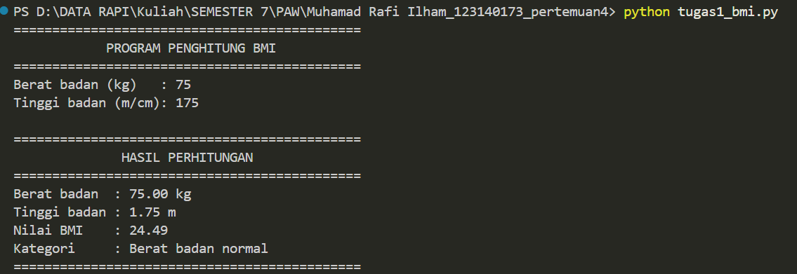
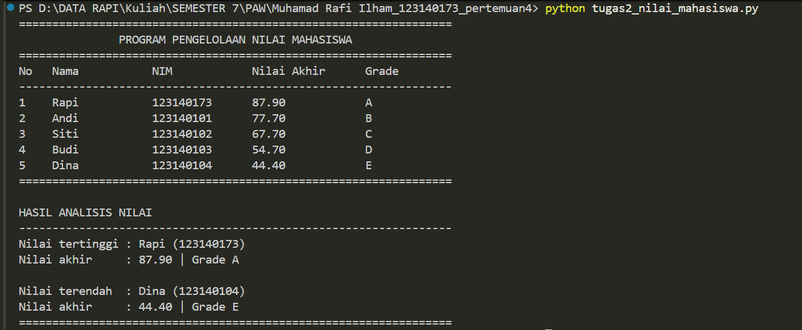
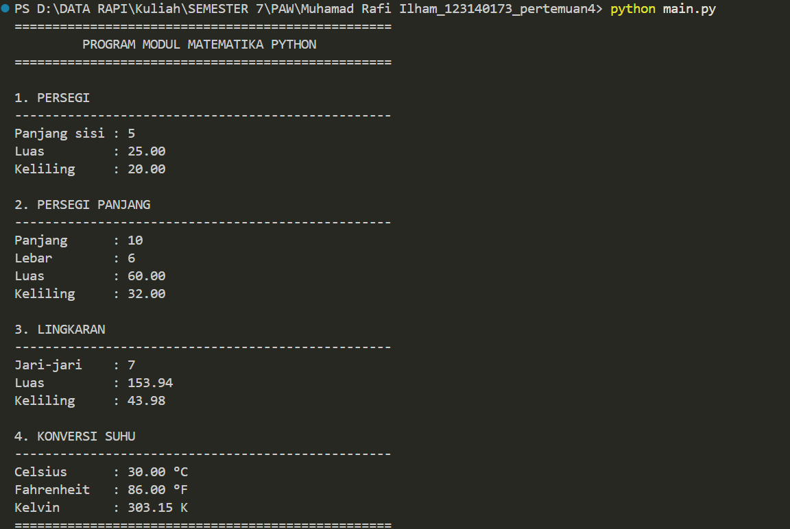

# Praktikum PAW - Pertemuan 4

- **Nama:** Muhamad Rafi Ilham
- **NIM:** 123140173
- **Kelas:** RB

## 1. Deskripsi
Praktikum ini menerapkan dasar pemrograman Python, meliputi variabel, operator, percabangan, perulangan, fungsi, struktur data, dan modul.

Terdapat tiga tugas yang dikerjakan:

1. **Penghitung BMI (`tugas1_bmi.py`)**
   Menghitung BMI berdasarkan berat dan tinggi badan (meter atau cm), kemudian menentukan kategori berat badan menggunakan percabangan `if-elif-else`.

2. **Pengelolaan Nilai Mahasiswa (`tugas2_nilai_mahasiswa.py`)**
   Mengolah data lima mahasiswa menggunakan list dan dictionary, menghitung nilai akhir (UTS 30%, UAS 40%, Tugas 30%), menentukan grade A–E, serta menampilkan nilai tertinggi dan terendah.

3. **Modul Matematika (`math_operations.py` dan `main.py`)**
   Menghitung luas dan keliling persegi, persegi panjang, lingkaran, serta konversi suhu Celsius ke Fahrenheit dan Kelvin. Program menggunakan dua cara import modul.

## 2. Teknologi
- Python 3.13.3
- Visual Studio Code
- Git dan GitHub

## 3. Cara Menjalankan
Buka folder praktikum di VS Code, kemudian jalankan perintah berikut melalui terminal:

**Tugas 1 - BMI**
```bash
python tugas1_bmi.py
```

**Tugas 2 - Nilai Mahasiswa**
```bash
python tugas2_nilai_mahasiswa.py
```

**Tugas 3 - Modul Matematika**
```bash
python main.py
```

## 4. Screenshot Hasil Pengujian

### Tugas 1 - Penghitung BMI


### Tugas 2 - Nilai Mahasiswa


### Tugas 3 - Modul Matematika


## 5. Kesimpulan
Ketiga program berhasil menerapkan konsep dasar Python untuk perhitungan, pengolahan data, dan penggunaan modul dengan kode yang terstruktur.